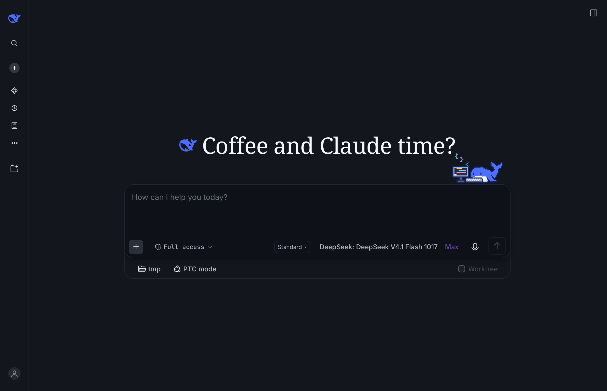
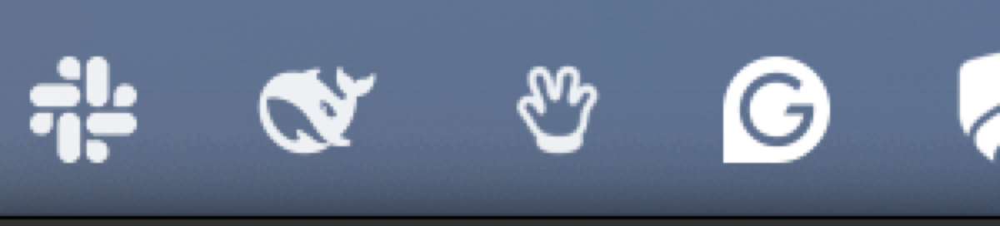

# dsh-menubar

DeepSeek Harness, one keystroke away — a macOS menu bar client that talks to a **running** `dsh web`
host, so every question you ask becomes a real, tracked session instead of a side process writing logs
nobody indexes.

Two halves, one idea:

| | |
|---|---|
| [`plugin/`](plugin) | A DeepSeek Harness host plugin, published as [`@gnanesh/dsh-menubar`](https://www.npmjs.com/package/@gnanesh/dsh-menubar). Mounts a token-authenticated WebSocket bridge and projects calls onto the host's own Typert Remotes. |
| [`app/`](app) | An AppKit menu bar app. A ⌃⌥Q hotkey and a whale in the status bar; the window runs the real dsh interface by default. |

## What it looks like

The window, with the sidebar collapsed to its icon rail:



It is not a lookalike: that is the real dsh front end, booted inside the window through a
pre-authenticated URL, so tool cards, approvals, tabs and theme tokens all come from the shell.

The status item is dsh's own whale mark, drawn as a template image so it follows light and dark menu
bars — here in the menu bar, second from the left:



## Why a plugin instead of a subprocess

The Host owns session state. A child process (`dsh --profile headless "…"`) writes a durable log but
never registers it in `~/.dsh/storages/workspace.json`, so the session stays invisible in the GUI.
Calling the Host's own `session.create` / `session.prompt` through the bridge means the Host creates
the session: it appears in the sidebar, resumes, forks and replays like any other.

```
app ──WS──▶ plugin (inside the dsh host) ──Typert Remotes──▶ session.create / prompt / follow
```

## Install

```bash
# 1. the plugin, into the running profile
dsh plugin --profile web add @gnanesh/dsh-menubar
dsh web

# 2. the app
cd app && swift build -c release
```

Keep the app alive across logins with a LaunchAgent (`~/Library/LaunchAgents/co.gnanesh.dshmenubar.plist`):

```xml
<key>ProgramArguments</key>
<array><string>/path/to/dsh-menubar/app/.build/release/DSHMenubar</string></array>
<key>RunAtLoad</key><true/>
```

First boot mints `~/.dsh/menubar-token` (0600) and reuses it, so the app reconnects with no
copy-paste and survives host restarts.

## Usage

- **⌃⌥Q** toggles the window; the whale in the menu bar does the same. Right-click the whale for
  status and quit.
- The default surface is the **real dsh interface**, so tool cards, approvals, tabs and themes come
  from the shell. A **compact window** — our own transcript and composer — is the alternative.
- Sessions land in a **`menubar-sessions`** workspace, titled by the Host.
- **New session per open**; pick an existing one to continue it.
- **Live streaming** through `session/follow`, not polling; **Stop** issues `session.cancel`.
- **Paste**: text goes into the focused element on either surface; the compact window also accepts
  images and text files, read from `NSPasteboard` because a `file://` page gets no files through the
  DOM paste event.
- The window is borderless, resizable, draggable, and does not close on outside clicks — ✕ or Escape
  closes it.

## Configuration

Everything lives on the plugin's own row, which is where a bundle's configuration belongs:

**Plugins → `@gnanesh/dsh-menubar` → the `menubar` row → Configure**

Registered in `plugins.row.config` under the key `@gnanesh/dsh-menubar#menubar` (`<package name>#<row
id>`). The page carries:

- **Window** — *Full dsh interface* (default) or *Menu bar window*. Applies the next time the window
  opens; ⌃⌥Q reopens it.
- **Workspace** for new sessions.
- **Menu bar app** — state (Running with pid, or Stopped) plus **Start**, **Restart**, **Quit**.
  Quit runs `launchctl bootout`, so the app stays down; Start bootstraps the LaunchAgent first, which
  is why quitting is recoverable without a terminal.
- **Bridge** — the WebSocket URL and the token file path.

Preferences live in `~/.dsh/menubar.json`, written by the page and read by the app, so there is one
source of truth over two surfaces:

| Endpoint | Purpose |
|---|---|
| `GET/POST /menubar/prefs` | read and write `{ui, workspacePath}` |
| `GET /menubar/app` | `{running, pid, loaded}` from `launchctl print` |
| `POST /menubar/app` | `{"action": "start" \| "stop" \| "restart"}` |
| `GET /menubar/bridge-config` | discovery: `wsUrl`, pre-authenticated `appUrl`, workspace, token file, methods |

Two rules a client half must follow here, both learned the hard way:

1. **Declare the slot before registering into it** — `ctx.slots.inject("plugins.row.config", () =>
   ctx.slots.register(...))`. Registering directly is rejected with *"slot is not declared (a parent
   entry's children table must declare it)"*.
2. **A failing entry blocks the whole boot** (*"Failed to load plugins"*), and an inject edge naming a
   non-entry — such as the shell-internal `dsh-client-ui-slots` library — leaves the entry in
   `loading` forever. Depend only on real boot entries, and wrap the factory and `apply` in
   try/catch: the worst case is then a missing page, never a dead GUI. The factory `id` must also
   equal the package name, or a stale page that still holds the previous bundle registers it twice
   (*"duplicate factory registration"*).

## Bridge protocol

```
client → host:  {t:"hello", token}         {t:"rpc", id, method, payload}   {t:"unfollow"}
host → client:  {t:"hello.ok", …}          {t:"rpc.result", id, ok, value|error}
                {t:"event", payload}       {t:"pong"}   {t:"error", code, message}
```

Methods: `session.create`, `session.prompt`, `session.cancel`, `session.history`, `session.list`,
`session.models`, `session.selectModel`, `session.follow`, `workspace.list`, `workspace.create`,
`menubar.prefs`.

`session.follow` starts a long-lived stream; the Host acknowledges immediately and then pushes
`assistant-stream` frames (text and reasoning deltas) plus durable `event` entries until `turn/end`.

## Releasing and being listed

Pushing a `v*` tag is the release (`.github/workflows/release.yml`): the tag is checked against
`plugin/package.json`, every entry is syntax-checked, the package is published to npm over OIDC
trusted publishing with provenance, and the GitHub release is written from `CHANGELOG.md`. No token
and no OTP: the only setup is the trusted publisher (repo `GnaneshKunal/dsh-menubar`, workflow
`release.yml`, environment `release`) plus the repository variable `NPM_PUBLISH=true`.

[`scripts/submit-awesome.sh`](scripts/submit-awesome.sh) submits the plugin to
[awesome-dsh-plugin](https://github.com/awesome-dsh-plugin/awesome-dsh-plugin) — fork, one
`data/plugins/<owner>__<repo>.yml`, PR. That list requires the repository to be at least one day old
and enforces it in CI, so the submission is armed as a **dsh schedule** (a durable reminder that
reopens the session when due, visible under Automation tasks); the script is idempotent and stops if
the entry or the PR already exists.

## Debug hooks

The app reads these from the environment, which is how the screenshots in `assets/` are reproducible
instead of hand-cropped:

| Variable | Effect |
|---|---|
| `DSHBRIDGE_DEBUG=1` | stderr tracing (connections, paste, layout, snapshots) |
| `DSHBRIDGE_WINDOW_SIZE=1180x760` | initial window size |
| `DSHBRIDGE_SNAPSHOT=/path.png` | write the webview exactly as rendered |
| `DSHBRIDGE_SNAPSHOT_DELAY=14` | wait before that snapshot |
| `DSHBRIDGE_EVAL='js'` | run one snippet after load (e.g. collapse the sidebar) |
| `DSH_MENUBAR_UI=native\|embedded` | override the stored surface for one run |

## Limits

- Binary file contents can't be attached on the embedded surface: the shell owns its own paste
  pipeline, and the bridge has no upload route yet.
- The model selector doesn't reflect a picked session's current model.
- Requires a loopback `dsh web`; the bridge is authenticated but not transport-encrypted, so don't
  expose the port through a tunnel without TLS.

MIT licensed.
