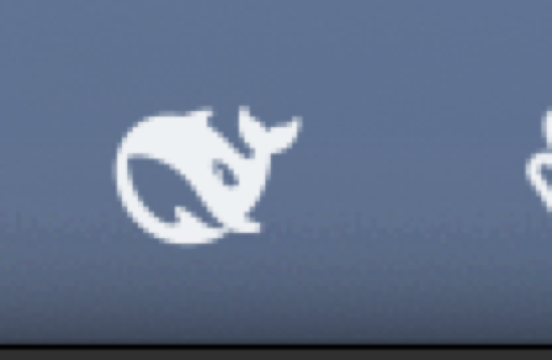

# dsh-menubar

DeepSeek Harness, one keystroke away — a macOS menu bar client that talks to a **running** `dsh web`
host, so every question you ask becomes a real, tracked session instead of a side process writing
logs nobody indexes.

Two halves, one idea:

| | |
|---|---|
| [`plugin/`](plugin) | A DeepSeek Harness host plugin. Mounts a token-authenticated WebSocket bridge and projects calls onto the host's own Typert Remotes. |
| [`app/`](app) | A SwiftUI-free AppKit menu bar app. Hotkey → floating chat window → streaming answers, rendered from a local web UI. |

## What it looks like

The window, with the sidebar collapsed to its icon rail:


It is not a lookalike: that is the real dsh front end, booted inside the window through a
pre-authenticated URL, so tool cards, approvals, tabs and theme tokens all come from the shell.

The status item is dsh's own whale mark, drawn as a template image so it follows light and dark menu
bars:



## Why a plugin instead of a subprocess

The Host owns session state. A child process (`dsh --profile headless "…"`) writes a durable log but
never registers it in `~/.dsh/storages/workspace.json`, so the session is invisible in the GUI
forever. Calling the Host's own `session.create` / `session.prompt` through the bridge means the
session is created by the Host: it appears in the sidebar, resumes, forks and replays like any other.

```
app ──WS──▶ plugin (inside the dsh host) ──Typert Remotes──▶ session.create / prompt / follow
```

## Install

```bash
# 1. plugin into the web profile (or use plugin_manager install_bundle)
dsh plugin --profile web add /path/to/dsh-menubar/plugin
dsh web                     # restart the host

# 2. app
cd app && swift build -c release
.build/release/DSHMenubar   # or keep it alive with a LaunchAgent
```

First boot mints `~/.dsh/menubar-token` (0600) and reuses it forever, so the app reconnects with no
copy-paste and survives host restarts.

## What it does

- **⌃⌥Q** summons the window from the whale in the menu bar (the official mark, shipped as a template SVG).
- The default surface is the **real dsh interface** embedded in the window, so tool cards, approvals and
  theme tokens come for free; the compact window remains available in Settings → Menu Bar.
- Sessions land in a **`menubar-sessions`** workspace, named by the Host's generated titles.
- **New session per open**; pick an existing one to continue it — switching loads that session's
  history into the transcript.
- **Live streaming**: text and reasoning arrive from the host's `session/follow`, not polling.
- **Reasoning** renders as a collapsed `Think` block.
- **Stop** cancels the running turn (`session.cancel`).
- **Markdown** rendered with vendored `marked` + `DOMPurify`.
- **Paste anything**: images go to the model as real image parts, text files are inlined, plain text
  inserts at the caret. Read natively from `NSPasteboard`, because a `file://` page gets an empty
  `clipboardData` for files.
- Window is draggable, stays put on outside clicks, closes on ✕ or Escape.

## Settings page

The plugin contributes a **Menu Bar** section to DSH Settings (`settings.section`, order 25): choose
the window surface (full dsh interface vs. compact menu bar window), set the workspace new sessions
join, and see the bridge URL and token file. Preferences live in `~/.dsh/menubar.json` and are read by
both sides — the page through `GET/POST /menubar/prefs`, the app through the bridge's `menubar.prefs`
call — so there is one source of truth. A surface change applies the next time the window opens.

Two rules a client half must follow here, both learned the hard way:

1. **Declare the slot before registering into it** — `ctx.slots.inject("settings.section", () => ctx.slots.register(...))`.
   Registering directly is rejected with *"slot is not declared (a parent entry's children table must declare it)"*.
2. **A failing entry blocks the whole boot** (*"Failed to load plugins"*), and an inject edge naming a
   non-entry — such as the shell-internal `dsh-client-ui-slots` library — leaves the entry in `loading`
   forever. So: depend only on real boot entries, and wrap the factory and `apply` in try/catch. The worst
   case is then a missing settings page, never a dead GUI.

## Settings

The plugin registers a **Menu Bar** page in DSH Settings (`settings.section`): choose the window
surface (compact menu bar window vs. the full dsh interface), set the workspace new sessions join,
and see the bridge URL and token file.

Preferences live in `~/.dsh/menubar.json` and are read by both sides — the page through
`GET/POST /menubar/prefs`, the app through the bridge's `menubar.prefs` call — so there is one source
of truth. The surface change applies on the next window open.

> Installing or updating the plugin's client half needs one host restart before the page appears:
> `dsh-client-modules` composes the boot graph at startup, so `/plugins/dsh-menubar/client.js` 404s
> until then.

## Bridge protocol

```
client → host:  {t:"hello", token}         {t:"rpc", id, method, payload}   {t:"unfollow"}
host → client:  {t:"hello.ok", …}          {t:"rpc.result", id, ok, value|error}
                {t:"event", payload}       {t:"pong"}   {t:"error", code, message}
```

Methods: `session.create`, `session.prompt`, `session.cancel`, `session.history`, `session.list`,
`session.models`, `session.selectModel`, `session.follow`, `workspace.list`, `workspace.create`.

`session.follow` starts a long-lived stream; the Host acknowledges immediately and then pushes
`assistant-stream` frames (token and reasoning deltas) plus durable `event` entries until `turn/end`.

## Limits

- Binary file contents can't be attached: the Host accepts files only through upload receipts, and
  the bridge has no upload route yet.
- The model selector doesn't reflect a picked session's current model.
- Requires a loopback `dsh web`; the bridge is authenticated but not transport-encrypted, so don't
  expose the port through a tunnel without TLS.

MIT licensed.
